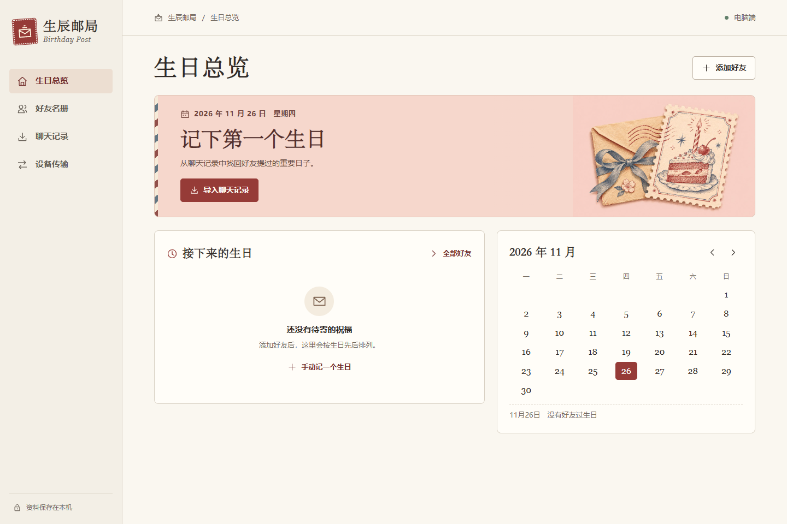
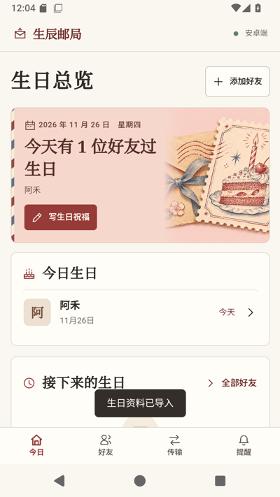

# Birthday Post（生辰邮局）

<div align="center">
     
</div>

生辰邮局帮你记住好友的生日，也记住写祝福时用得上的小事。在 Windows 上导入聊天记录，核对好友提过的生日、称呼、爱好和心愿。把确认后的好友卡传到手机，生日当天就能收到提醒，编辑一段祝福，复制到常用聊天软件发送。提取和生成都在本机完成，无需账号或 API 密钥。

**[下载 1.0.0 完整包](https://github.com/GPDdev/BirthdayPost/releases/download/v1.0.0/BirthdayPost-1.0.0.zip)**　[查看所有版本](https://github.com/GPDdev/BirthdayPost/releases)　[使用说明](./使用说明.txt)

[安装](#安装)　[第一次使用](#第一次使用)　[数据与历法](#数据与历法)　[构建与测试](#构建与测试)　[贡献](#贡献)　[许可证](#许可证)



## 安装

| 平台 | 安装和使用 |
| --- | --- |
| Windows | 双击运行，电脑需要已安装 Microsoft Edge。[下载 EXE](https://github.com/GPDdev/BirthdayPost/releases/download/v1.0.0/BirthdayPost-Windows.exe) |
| Android 8.0 及以上 | 安装 APK，在「传输」中导入好友卡，再到「提醒」选择时间并允许系统通知。[下载 APK](https://github.com/GPDdev/BirthdayPost/releases/download/v1.0.0/BirthdayPost-Android.apk) |
| iPhone，免编译 | 安装 Scriptable，在「文件」中打开脚本或分享给 Scriptable，添加后运行。完整包内也有可直接使用的 `.js` 文件。[安装 Scriptable](https://apps.apple.com/cn/app/scriptable/id1405459188)　[下载脚本](https://github.com/GPDdev/BirthdayPost/releases/download/v1.0.0/BirthdayPost-iPhone.scriptable) |
| iPhone，原生应用 | 在 Mac 上打开 Xcode 工程，选择开发团队和 Bundle Identifier 后运行到 iOS 16 及以上设备。[打开工程目录](./ios/BirthdayPost.xcodeproj) |

## 第一次使用

1. 在电脑端打开「聊天记录」，选择文件或粘贴文本。如果自己在记录里显示为昵称，请填入该昵称。可以先用仓库里的示例试一次。[示例聊天.txt](./示例聊天.txt)
2. 点开待核对好友，对照原句确认生日和祝福素材。例如，下面这段会给小禾提取出公历 5 月 18 日、称呼「阿禾」、兴趣「骑行」和心愿「骑完环湖线」。核对后点「确认并收录」。

   ```text
   小禾：我的生日是5月18日。你可以叫我阿禾。
   小禾：我平时喜欢骑行。我今年想骑完环湖线。
   ```

3. 在「设备传输」导出生日资料包，把 JSON 文件传到手机。手机端导入后开启提醒，默认是手机当地时间上午 9 点。
4. 生日当天点开通知或「今日生日」，选中好友。可以选自然、俏皮或郑重的语气，也可以直接改正文。点「复制祝福」，到聊天窗口粘贴发送。

<details>
<summary>查看 Android 端的今日生日界面</summary>



</details>

## 数据与历法

| 项目 | 处理方式 |
| --- | --- |
| 聊天记录 | 支持可读的 TXT、CSV、TSV、JSON，每个文件最多 32 MB。微信或 QQ 的加密备份需要先转换成可读记录。 |
| 日期核对 | 本人自述、单聊中的生日问答和带日期的生日问候可提供线索。遇到不同日期会列出候选，提前祝福或补祝的日期需结合原句核对。 |
| 好友资料包 | 可读的 JSON 只携带已确认的好友编号、姓名、生日、称呼、关系、兴趣和心愿。聊天原句仅在电脑核对期间暂存。重复导入按好友编号更新，手机上的祝福草稿会保留。 |
| 公历与农历 | 公历 2 月 29 日仅在闰年提醒。农历按 1901 至 2100 农历年换算，闰月生日和农历三十仅在对应日期存在时提醒。 |
| 提醒排期 | 安卓由系统闹钟唤起，省电策略可能延后通知。iPhone 的 Scriptable 版在打开时续排本地通知，提醒设置会显示已排到的日期。 |

## 构建与测试

共享界面和日历逻辑在 `web/`。Windows 启动器在 `desktop/`，安卓工程在 `android/`，Swift 工程和免编译脚本在 `ios/`。发行文件由 `tools/build.py` 生成。

在 Windows 上构建三端发行包需要 Python 3.10 或更高版本、.NET Framework 的 C# 编译器、JDK 和 Android SDK。1.0.0 使用 JDK 21、Android SDK Platform 36 和 Build Tools 35.0.0 构建。将 `ANDROID_SDK_ROOT` 指向本机 SDK 目录后运行以下命令，成品位于 `dist/`。

```powershell
python tools/build.py desktop android iphone
python tests/check-package.py
```

仅运行共享逻辑和 Scriptable 接口测试时，用 Python 生成脚本包，再用 Node.js 执行测试即可。

```powershell
python tools/build.py iphone
node --test tests/core.test.cjs tests/iphone-script.test.cjs
```

1.0.0 通过了 14 项自动化测试。Windows 已验证实际 EXE 启动、文件导入导出及剪贴板。Android 16 模拟器已验证从系统文件选择器导入、后台到点通知及点击回到当日名单。iPhone 的验证覆盖 WebKit 界面和模拟宿主接口，真机通知及 Xcode 编译签名仍待验证。

## 贡献

如果遇到聊天格式无法识别，欢迎提交一个最小的虚构对话，注明文件格式、预期生日和实际识别结果，方便复现。[提交 Issue](https://github.com/GPDdev/BirthdayPost/issues)

## 许可证

Birthday Post 采用 Apache License 2.0。[许可证全文](./LICENSE)　[版权声明](./NOTICE)
